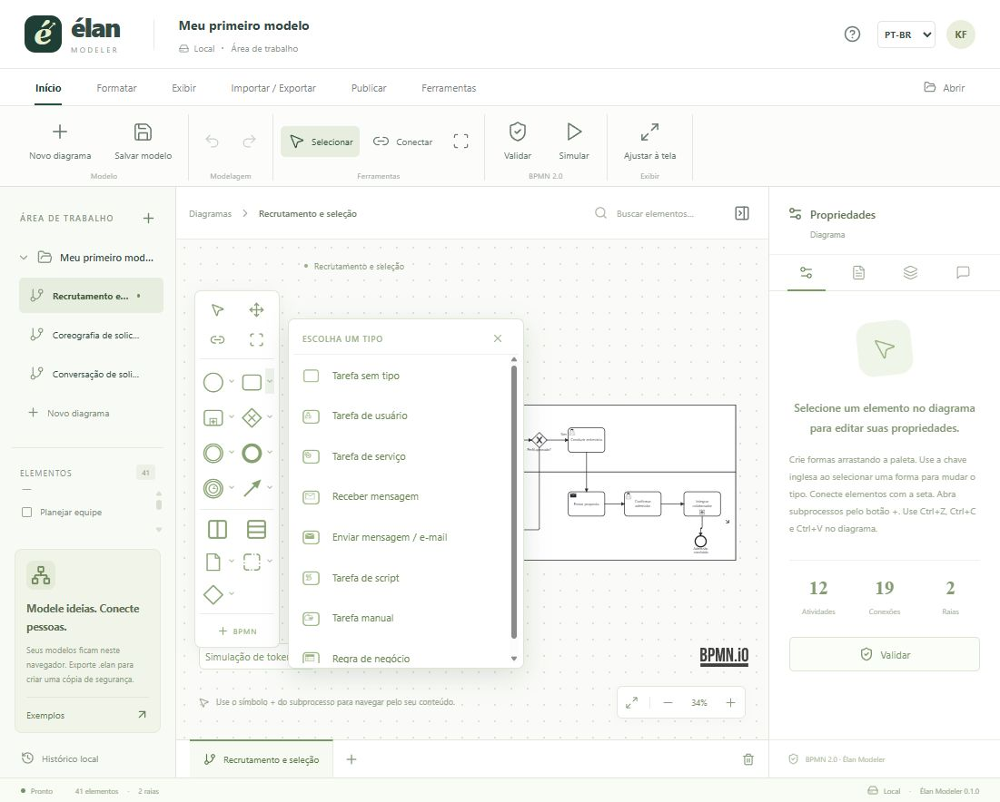

# Élan Modeler

Um modelador BPMN em português brasileiro e inglês, com nome francês: **élan**, impulso para avançar. Implementação independente, sem vínculo com a Bizagi.



## Executar

Para publicar na web, siga o [guia de deploy manual na Vercel com Turso](docs/deploy-vercel-turso.md). A configuração está pronta no repositório; você cria o banco, executa a migração e importa o projeto no painel da Vercel.

Use Node.js **22.18 ou superior** e npm.

```bash
npm ci
npm run dev
```

Abra o endereço local exibido pelo Vite. Para usar como aplicativo desktop:

```bash
npm run desktop
```

Para gerar o executável portátil Windows:

```bash
npm run desktop:package
```

O resultado fica em `release/`. O executável não possui assinatura de código comercial.

## Modelagem

- Processos e colaborações, pools, raias, vários documentos e vários diagramas no mesmo XML.
- Tarefas sem tipo, de usuário, serviço, envio, recebimento, script, manuais e de regras de negócio.
- Subprocessos recolhidos/expandidos, subprocessos de evento, transações, subprocessos ad hoc e atividades de chamada.
- Eventos iniciais, intermediários de captura/lançamento, de borda e finais, com os gatilhos e resultados disponíveis no catálogo.
- Eventos múltiplos, múltiplos paralelos, interruptivos e não interruptivos nos contextos apropriados.
- Gateways exclusivos, paralelos, inclusivos, complexos e baseados em eventos, incluindo variantes que iniciam instâncias.
- Sequência, condição, caminho padrão, mensagem, associações dirigidas/bidirecionais, associações de dados e vínculos de conversação.
- Objetos de dados, coleções, data stores, entradas e saídas, grupos e anotações.
- Coreografia com motor especializado **chor-js**; conversação com renderização e atualização semântica próprias.
- Temporizadores ISO 8601, condições, referências de mensagem/sinal/erro/escalação, repetição e múltiplas instâncias.
- Definições BPMN, recursos, interfaces, tarefas globais, propriedades do metamodelo e edição do XML completo.
- Documentação por elemento, atributos Élan, comentários locais resolvíveis, histórico local e simulação interativa de tokens.
- Marcos/fases como **extensão Élan** sobre grupos BPMN; não são uma notação normativa adicional do padrão.

Na paleta, clique na seta de uma família para escolher o tipo e coloque-o no diagrama. Eventos de borda devem ser colocados na borda de uma atividade. Use **Propriedades** para configurar detalhes; **Ferramentas → Definições** para manter definições globais; **Ferramentas → Reutilizáveis** para criar processos chamados por `CallActivity`.

**Modelar não executa o processo.** Uma tarefa de envio pode representar e-mail; serviços, scripts e regras precisam de um motor de execução e integrações para realizar trabalho real.

## Arquivos

| Formato                               | Situação                                                                                |
| ------------------------------------- | --------------------------------------------------------------------------------------- |
| BPMN 2.0 XML                          | Formato nativo de intercâmbio; conserva semântica e DI através do motor correspondente. |
| `.elan`                               | Modelo JSON com vários documentos BPMN, comentários e nomes.                            |
| XPDL 2.1/2.2                          | Importação experimental; exportação de um subconjunto de processos em XPDL 2.2.         |
| Visio VDX/VSDX                        | Importação experimental; exportação VDX de formas e conexões genéricas.                 |
| XML de atributos                      | Esquema Élan; não é o esquema de atributos Bizagi.                                      |
| SVG, PNG, JPG                         | Exportação do diagrama aberto.                                                          |
| PDF, DOCX, XLSX, HTML, CSV            | Documentação e inventário dos elementos do documento ativo.                             |
| Bizagi `.bpm` / `.bpmc`, Visio `.vsd` | Sem leitura/escrita nativa. Exporte BPMN no aplicativo de origem.                       |

Os adaptadores XPDL/Visio não prometem preservação integral, nem substituem BPMN XML para coreografias ou conversações. Veja a [pesquisa detalhada de compatibilidade](docs/compatibilidade-bizagi.md).

## Cobertura e limites

O objetivo do projeto é ampliar a cobertura de modelagem BPMN 2.0.2. **Esta versão não é uma certificação de cobertura integral do padrão nem uma reprodução completa de todos os serviços do Bizagi.** O catálogo, os testes e as lacunas estão na [matriz de cobertura](docs/cobertura-bpmn.md).

Colaboração em nuvem, autenticação, SharePoint/MediaWiki, mineração de processos, análise quantitativa BPSim e execução produtiva não estão implementadas. A simulação de tokens não calcula calendários, capacidade, custos ou distribuições estatísticas. A validação verifica um conjunto explícito de regras estruturais; revisão semântica continua necessária.

O salvamento local continua automático. A versão web também oferece **Nuvem** para salvar, abrir, atualizar e arquivar modelos em um banco Turso por uma API na Vercel. O envio à nuvem é manual nesta etapa, preserva os documentos/XML e comentários e detecta conflitos entre abas por revisão. O workspace é público, sem login, conforme a configuração escolhida. As credenciais do Turso ficam no servidor. Consulte [a API](docs/backend-api.md) e [o setup](docs/deploy-vercel-turso.md).

**Exporte `.elan` para manter cópias de segurança.** O limite de armazenamento local depende do ambiente; o aplicativo mostra um aviso se o salvamento falhar. O histórico local mantém até 20 versões e não é incluído no arquivo `.elan` nem sincronizado com o banco. Na nuvem, o limite por projeto é 3 MiB; projetos maiores continuam utilizáveis localmente. Não há analytics ou dependência de fontes externas.

## Conectar IA com MCP

O botão **Conectar IA** fornece a URL do servidor e instruções para ChatGPT, Notion e outros clientes MCP. O endpoint público é **`https://SEU-DOMINIO/mcp`**, sem chave. Inclui 12 ferramentas para consultar, criar e editar os modelos salvos no Turso, com controle de revisão. O Notion tem uma rota opcional com autenticação por cabeçalho, exigida pelo cliente. Veja o [guia de configuração e uso](docs/mcp.md).

## Verificar

```bash
npm test
npm run build
```

Para integração real no navegador, execute o servidor e abra `/qa.html`, depois clique em **Run integration checks**. A página usa diagramas descartáveis em memória, cria cada variante, exporta XML, reabre e confere os elementos. Também testa conexões, temporizador, conversação e alternância entre os motores de coreografia e processo. Consulte [o relatório de validação](docs/validacao.md).

## Organização

- `src/App.tsx`: interface, documentos, salvamento, navegação e publicação.
- `src/catalog.ts`, `BpmnPalette.tsx`: catálogo e seleção direta de elementos.
- `src/SemanticEditor.tsx`, `DefinitionsEditor.tsx`: propriedades BPMN e definições globais.
- `src/HybridModeler.ts`: seleção do motor adequado ao diagrama.
- `src/conversation.ts`, `connections.ts`: conversações, dados de entrada/saída e conexões explícitas.
- `src/interchange.ts`: adaptadores, proteção do parser XML e downloads.
- `src/reports.ts`: documentação PDF/Word/Excel/HTML/CSV.
- `desktop/main.cjs`: shell Electron com sandbox e isolamento de contexto.
- `qa/`: verificações de integração no navegador.
- `examples/`: arquivos BPMN editáveis.

O vídeo e os anexos fornecidos para pesquisa **não fazem parte do repositório público**. Licenças e atribuições de dependências estão em [THIRD_PARTY_NOTICES.md](THIRD_PARTY_NOTICES.md).

For English instructions, see [README.en.md](README.en.md).
